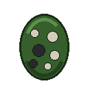

# Vivero (Tree Nursery) Mod for Luanti / Minetest

**Vivero** (Spanish for "tree nursery") is a mod for [Luanti](https://www.luanti.org) / Minetest that introduces a tree nursery NPC. The NPC wanders around the world, running and walking naturally, and plants random tree saplings in suitable soil locations.



---

## Features

- **Game-Independent Sapling Detection**:
  Dynamically scans registered nodes for any node containing `"sapling"` in its name (e.g. `default:sapling`, `default:acacia_sapling`, `mcl_core:oak_sapling`, etc.), making it work out-of-the-box across Minetest Game, MineClone 2 / VoxeLibre, and custom games.

- **Smart Planting Conditions**:
  Before placing a sapling, the NPC checks:
  1. Soil or dirt underneath (`group:soil`, `group:crumbly`, or dirt/grass nodes).
  2. Sunlight/light level (at least light level 8).
  3. At least 3x3 horizontal open area and vertical clearance for proper tree growth.

- **Natural Movement & AI**:
  - State machine with idle/standing, walking, running, and planting states.
  - Auto-jumps over 1-block high terrain obstacles.
  - Changes direction smoothly when encountering tall walls or drop-offs.
  - Uses full 3D keyframe mesh animations (`vivero_char.b3d`).

- **Combat & Environmental Interactions**:
  - Has 20 HP, takes player punch damage, and suffers directional knockback.
  - Buoyant in water: swims upward naturally to stay afloat, with drowning damage if completely submerged.
  - Lava damage: takes lava burn damage and spawns flame particles.
  - Drops a spawn egg or a random sapling upon death.

- **Spawn Egg & Crafting**:
  - Spawn egg item (`vivero:spawn_egg`) allows players to place Vivero NPCs in survival or creative mode.
  - Craftable recipe:
    ```text
    [ Sapling ] [ Sapling ] [ Sapling ]
    [ Sapling ] [  Soil   ] [ Sapling ]
    [ Sapling ] [ Sapling ] [ Sapling ]
    ```

---

## Installation

1. Copy the `vivero` folder into your Luanti/Minetest `mods/` directory.
2. Enable the `vivero` mod in your world settings.

---

## License

- **Code & Textures**: MIT License (c) 2026 ronrob-lu.
- **Character Model (`models/vivero_char.b3d`)**: Derived from original Minetest `character.b3d`, licensed under CC BY-SA 3.0.

See `LICENSE.md` for full license details.
